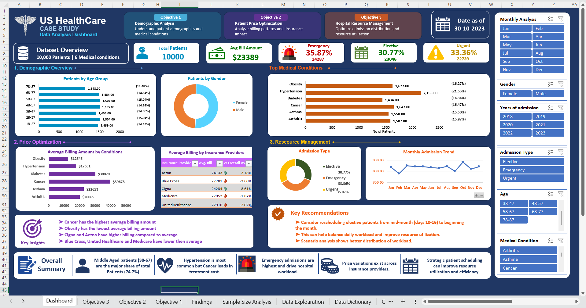

# Hospital Analysis — Excel Healthcare Case Study

An end-to-end **Excel data analysis and dashboard project** built around a healthcare case-study dataset of **10,000 patient records**. The project covers data cleaning, exploratory analysis, PivotTables, slicers, charts, billing analysis, insurance comparisons, admission trends, and scenario-based resource planning.

## Dashboard Preview



## Project Overview

The objective of this project was to turn a raw healthcare dataset into a structured Excel analysis that can support three business questions:

1. **Demographic Analysis** — understand patient demographics and medical-condition distribution.
2. **Patient Price Optimization** — analyze billing patterns and the effect of insurance providers and admission types.
3. **Hospital Resource Management** — understand admission patterns and test scenarios for improving the distribution of elective admissions.

The final workbook contains both the source data and the analysis workflow, making it possible to trace the project from raw records to dashboard insights.

## Dataset

- **Records:** 10,000 patient records
- **Original fields:** 15
- **Cleaned/analysis fields:** 20, including derived analysis columns
- **Main dimensions:** age, gender, blood type, medical condition, admission/discharge dates, doctor, hospital, insurance provider, billing amount, admission type, medication, and test results

## Data Preparation

The raw data contained several formatting and consistency issues. The cleaning process included:

- Standardizing inconsistent gender values, including `M` to `Male`.
- Standardizing medical-condition capitalization.
- Cleaning inconsistent blood-type representations.
- Standardizing admission-type values, including `Emer` to `Emergency`.
- Cleaning and standardizing the billing field and handling blank/inconsistent entries.
- Formatting admission and discharge dates.
- Creating helper fields for **Age Group**, **Age + Gender**, **Month of Admission**, **Year of Admission**, and the **day extracted from the admission date**.
- Reviewing fields that were not required to answer the three business objectives.

## Analysis Performed

### Objective 1 — Demographic Analysis

The analysis examines:

- Patient distribution by age group.
- Gender distribution.
- Medical-condition prevalence.
- Medical conditions across age groups.
- Medical conditions by gender and age-gender combinations.
- Blood-type distribution.

### Objective 2 — Patient Price Optimization

The analysis examines:

- Average billing amount by medical condition.
- Average billing amount by insurance provider.
- Insurance-provider variance versus the overall average billing amount.
- Admission-type distribution and average billing amount.

### Objective 3 — Hospital Resource Management

The analysis examines:

- Monthly admission volume.
- Daily admission distribution across a month.
- Elective, emergency, and urgent admission patterns.
- Scenario analysis for shifting elective admissions toward the beginning of the month.

The workbook includes two scheduling scenarios. In **Scenario 1**, moving elective admissions from the mid-month period into the first week reduces the modeled maximum daily admission volume from **497 to 381**, while the total number of admissions remains unchanged. The modeled daily-volume standard deviation falls from about **80.0 to 28.8**.

## Key Insights

Based on the cleaned dataset and the analysis in the workbook:

- **Hypertension** is the most common medical condition, representing **21.55%** of patients.
- **Cancer** has the highest average billing amount at approximately **$39,678**, while **Obesity** has the lowest at approximately **$12,545**.
- **Emergency admissions** are the largest admission category at **35.87%** of patients.
- Emergency admissions also have the highest average billing amount among the three admission types, at approximately **$24,287**.
- **October** has the highest monthly admission count (**883**), while **February** has the lowest (**778**).
- **Cigna** has the highest average billing amount among the five insurance providers at approximately **$24,234**, compared with an overall average of approximately **$23,389**.
- The scheduling scenario demonstrates how redistributing elective admissions can reduce modeled daily-volume variation without changing the overall admission count.

## Excel Features & Techniques

- Excel Tables and structured worksheet organization
- PivotTables and PivotCharts
- Interactive slicers
- Conditional formatting
- Helper columns and calculated fields
- Data cleaning and standardization
- Date-based analysis
- Scenario analysis
- Dashboard design and KPI cards

## Workbook Structure

| Sheet | Purpose |
|---|---|
| **Dashboard** | Interactive executive-style dashboard with KPIs, charts, slicers, insights, and recommendations |
| **Objective 1** | Demographic and medical-condition analysis |
| **Objective 2** | Billing and insurance analysis |
| **Objective 3** | Admission and resource-management analysis, including scenarios |
| **Findings** | Consolidated findings and supporting analysis tables |
| **Sample Size Analysis** | Checks of category distributions and sample adequacy |
| **Data Exploration** | Filtered/exploratory data view used during analysis |
| **Data Dictionary** | Field definitions and notes on cleaning decisions |
| **Cleaned Data** | Standardized dataset with derived helper fields |
| **Raw Data** | Original 10,000-row dataset |

## Repository Structure

```text
hospital-analysis-excel/
├── README.md
├── .gitignore
├── workbook/
│   └── Hospital_Analysis_Project.xlsx
└── assets/
    └── hospital-analysis-dashboard.png
```

## How to Use

1. Open `workbook/Hospital_Analysis_Project.xlsx` in Microsoft Excel.
2. Start with the **Dashboard** sheet for the high-level view.
3. Use the slicers to filter the dashboard by month, gender, year, admission type, age group, and medical condition.
4. Open the objective sheets and supporting analysis sheets to trace the calculations and findings.

> **Note:** GitHub can preview the workbook file, but Excel interactivity such as slicers, PivotTables, and workbook-level objects is best experienced by opening the `.xlsx` file in Microsoft Excel.

## Limitations & Notes

This is a portfolio/case-study analysis. The conclusions describe patterns in the supplied dataset and should not be interpreted as clinical conclusions. The resource-management section contains **hypothetical scheduling scenarios**, not actual hospital operating plans.

## Author

**Satyam Vishwakarma**

Data Analytics | Excel | SQL | Power BI | Python
